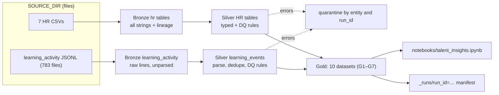

# ACME Talent Pipeline

[](https://github.com/Darshan-05032003/Citi-Data-Engineer-Workshop/actions/workflows/talent-pipeline.yml)

A single-file PySpark job (`job.py`) that turns ACME's HR extracts and learning-activity logs into a
Bronze → Silver → Gold lake, with data-quality rules, quarantine and a run manifest. The Gold layer
answers seven talent questions (performance trend, competency gaps, promotion shortlist, learning,
attrition context, team outcomes, competency coverage), shown in `notebooks/talent_insights.ipynb`.
Design decisions and metric definitions: [docs/DESIGN.md](docs/DESIGN.md).

## Setup

**Prerequisites:** Python 3.11 and Java 17 (Spark 3.5.0 runs on Java 17). For the cloud run only: AWS CLI, kubectl, Helm, Terraform.

```bash
cd data/talent-pipeline
scripts/fetch_dataset.sh      # downloads + sha256-checks the workshop dataset; skips if already present
scripts/setup_local.sh        # creates .venv (python3.11), installs requirements-dev.txt, checks Java 17 + pyspark 3.5.0
source .venv/bin/activate
```

- **Dataset:** <http://www.codingworkshop.net/data/data-engineering-sample-performance-scenario.zip>
  (sha256 `9c400617fc047583e765345f0b2489fa7f0bf30e759d432b3cc7e80f3625a0c8`). It unzips to
  `sampleData/data-engineering-sample-performance-scenario/data-engineering-performance-talent-management/` at the repo root,
  which is the default `SOURCE_DIR`. The dataset is git-ignored and never committed.
- **Manual equivalent of `setup_local.sh`:** `python3.11 -m venv .venv && .venv/bin/pip install -r requirements-dev.txt`, then
  in `.venv/bin/activate` set `export JAVA_HOME=<Java 17 home>`, `export PATH="$JAVA_HOME/bin:$PATH"` and `unset SPARK_HOME`.
  A `SPARK_HOME` pointing at another Spark version (for example 4.x) breaks the pip-installed pyspark 3.5.0.

## Architecture



## Run locally

```bash
cd data/talent-pipeline
source .venv/bin/activate        # Python 3.11, pyspark 3.5.0; activate sets JAVA_HOME=Java 17 and unsets SPARK_HOME
python job.py                    # full run, ~75 s (latest run manifest); writes ./lake
pytest -q                        # 64 unit + 5 integration = 69 tests (~6 min; the Postgres parity test skips without POSTGRES_* env)
cd notebooks && jupyter nbconvert --to notebook --execute --inplace talent_insights.ipynb
jupyter nbconvert --to html --output-dir ../docs talent_insights.ipynb
```

Run only the fast tests with `pytest -q -m "not integration"` (~70 s). They include in-process Bronze → Silver → Gold runs on a
hand-made mini dataset (`tests/fixtures/mini_source/`), the source guards (`tests/test_guards.py`) and give 98% line coverage of `job.py`:
`pytest -q -m "not integration" --cov=job --cov-report=term-missing`.

**CI** ([`.github/workflows/talent-pipeline.yml`](../../.github/workflows/talent-pipeline.yml), on every push/PR touching this folder):
unit tests with a 90% coverage gate → integration tests on the downloaded, sha256-checked dataset, including the files-vs-postgres
parity test, which runs against a `postgres:17` service container (throwaway CI-only credentials) and **fails instead of skipping**
if Postgres is unavailable (`REQUIRE_POSTGRES=1`); bandit scan of `job.py` (medium+ fails).

## Cloud deployment

The same `job.py` runs as a Kubernetes Job on EKS (image `jupyter/all-spark-notebook`, Spark 3.5.0) against an S3 data lake.
Procedure (from the repo root, with the workshop AWS credentials):

```bash
source ENVIRONMENT.config && unset AWS_ENDPOINT_URL AWS_ENDPOINT_URL_S3
B=$(cd infra && terraform output -raw datalake_bucket_name)          # coding-workshop-datalake-<app_id>
SRC=sampleData/data-engineering-sample-performance-scenario/data-engineering-performance-talent-management
aws s3 cp "$SRC" "s3://$B/source/" --recursive --exclude "*" --include "*.csv"    # 7 CSVs
aws s3 sync "$SRC/learning_activity" "s3://$B/source/learning_activity"          # 783 JSONL -> 790 objects total
kubectl delete job coding-workshop-talent-pipeline --ignore-not-found
export TF_VAR_aws_eks_enabled=true && ./bin/deploy-backend.sh aws                # re-installs the Helm job
kubectl logs -f job/coding-workshop-talent-pipeline                               # pod + logs kept 30 min after finish
```

- **Env vars injected by Helm** (`infra/eks.tf`): `IS_LOCAL=false`, `SOURCE_DIR=s3a://<bucket>/source`,
  `LAKE_ROOT=s3a://<bucket>/lake`, `AWS_REGION` (job.py then sets the regional `fs.s3a.endpoint`); `backoffLimit=1`, `ttlSecondsAfterFinished=1800`.
- **Credentials are a Kubernetes Secret** (`AWS_ACCESS_KEY_ID/SECRET_ACCESS_KEY/SESSION_TOKEN`, loaded with `envFrom`), filled from the
  deploying shell at apply time and never written to Terraform state. Reason: the EKS node role has no S3 permissions and the node
  requires IMDSv2 with hop limit 1, so pods cannot use instance credentials. They are short-lived STS credentials: run the job right
  after `deploy-backend.sh`. They are also kept in Helm's release record. Production would use IRSA (a pod IAM role) instead.
- **Runtime:** the cloud runs took 1,440–1,476 s versus ~90 s locally (run manifests before the file-layout change in docs/DESIGN.md#performance): the pod has 1 CPU, reads 783 small JSONL
  files over S3, and installs pyspark (~300 MB) with pip at start-up.
- **Result:** runs `20261015T071439Z-9de56f` and `20261015T084021Z-13ec40` succeeded; all 26 manifest steps match the local run
  (see [Cloud run (EKS)](docs/test_evidence.md#cloud-run-eks)).

## Notebook data source

The notebook reads Gold and the newest run manifest from `LAKE_ROOT`. This is an environment variable, the same one `job.py` uses:

| Mode | `LAKE_ROOT` | Reader |
|---|---|---|
| Local (default) | unset, which means `../lake` relative to `notebooks/` | `pyarrow.fs.LocalFileSystem` |
| S3 | `s3://coding-workshop-datalake-f2a96bad/lake` (`s3a://` also accepted) | `pyarrow.fs.S3FileSystem`, region from `AWS_REGION` (default `ap-south-1`) |

The notebook never contains credentials. In S3 mode it uses the standard AWS environment or profile chain, and it only reads.

```bash
# local (re-executes the committed notebook in place)
cd data/talent-pipeline/notebooks && jupyter nbconvert --to notebook --execute --inplace talent_insights.ipynb

# S3, from the repo root; writes a copy so the committed notebook keeps its local outputs
source ENVIRONMENT.config && unset AWS_ENDPOINT_URL AWS_ENDPOINT_URL_S3 && cd data/talent-pipeline/notebooks && \
  LAKE_ROOT=s3://coding-workshop-datalake-f2a96bad/lake jupyter nbconvert --to notebook --execute --output-dir /tmp/nb_s3 talent_insights.ipynb
```

Both modes give identical findings. In S3 mode the run line shows the cloud run `20261015T095920Z-649058`
([test evidence](docs/test_evidence.md#notebook-local-vs-s3)).

## Configuration (environment variables only)

| Variable | Default | Meaning |
|---|---|---|
| `IS_LOCAL` | `true` | Local run flag (recorded in the manifest) |
| `SOURCE_DIR` | `../../sampleData/data-engineering-sample-performance-scenario/data-engineering-performance-talent-management` (relative to `job.py`) | Folder with the 7 CSVs and `learning_activity/` |
| `LAKE_ROOT` | `<job.py folder>/lake` | Lake root; local path or `s3a://bucket` |
| `SOURCE_MODE` | `files` | Where the 7 HR tables come from: `files` (CSVs in `SOURCE_DIR`) or `postgres` (JDBC). Learning events always come from `SOURCE_DIR`. |
| `POSTGRES_HOST` / `POSTGRES_PORT` | `localhost` / `5432` | Postgres server (postgres mode) |
| `POSTGRES_NAME` / `POSTGRES_USER` / `POSTGRES_PASS` | — (required in postgres mode) | Database, user, password; the password is never logged or written to the manifest |
| `POSTGRES_SCHEMA` | `hr_source` | Schema holding the HR tables |

`org.apache.hadoop:hadoop-aws:3.3.4` and explicit S3A retry/backoff settings (`fs.s3a.attempts.maximum=10`,
`fs.s3a.retry.limit=7`, `fs.s3a.retry.interval=500ms`) are added to Spark only when `SOURCE_DIR` or `LAKE_ROOT` starts with `s3a://`;
`org.postgresql:postgresql:42.7.4` only when `SOURCE_MODE=postgres`. Nothing runs at import time; all config is read in `main()`.

## PostgreSQL source (SOURCE_MODE=postgres)

The 7 HR tables can be read from PostgreSQL over JDBC instead of the CSV files. The learning events still come from files.
The Bronze contract stays the same: every column is cast to string. Silver and Gold are therefore unchanged, and the
results are identical to files mode (26/26 steps, 10/10 Gold content hashes; see
[test evidence](docs/test_evidence.md#postgresql-source-mode)).

```bash
cd data/talent-pipeline
export POSTGRES_HOST=localhost POSTGRES_PORT=5432 POSTGRES_NAME=postgres POSTGRES_USER=postgres
export POSTGRES_PASS=...           # from your local setup; never commit it
scripts/load_source_postgres.sh    # idempotent: DROP/CREATE SCHEMA hr_source, then the dataset's own load.sh; prints 7 row counts
SOURCE_MODE=postgres python job.py
POSTGRES_NAME=… POSTGRES_USER=… POSTGRES_PASS=… pytest -q -m postgres   # files-vs-postgres parity test (skips without these vars)
```

- **SSL:** `IS_LOCAL=false` adds `sslmode=require` (Aurora). The JDBC URL never contains credentials.
- **Connection:** the job probes the connection first, retrying with backoff (1 try + 4 retries, 2/4/8/16 s, ~30 s), which
  covers Aurora Serverless resuming from 0 ACU. `connectTimeout=10` stops a dead host from hanging a try.
- **Guards:** the same checks as files mode run before anything is written (missing settings or table, schema drift,
  0 rows). The manifest records `source_mode`, and `source.hr.<table>.rows` per table.
- **Lineage:** `_source_system=postgres`, `_source_file=postgres://host:port/db.schema.table`.
- The loader never edits `load.sh` or `schema.sql`. It points `search_path` at the schema via `PGOPTIONS`. The original
  `load.sh` passes the password inside psql's connection string, so it is briefly visible in `ps` while loading.

## Lake layout

```
{LAKE_ROOT}/bronze/hr/<table>/ingest_date=YYYY-MM-DD/      CSV rows as strings + _run_id, _ingested_at, _source_system, _source_file
{LAKE_ROOT}/bronze/learning_activity/year=/month=/          raw line (value), _line_no, _source_file, _record_hash, day (1 file per month)
{LAKE_ROOT}/silver/<hr table>/                              typed, validated, dq_warnings
{LAKE_ROOT}/silver/learning_events/event_year=/event_month=/
{LAKE_ROOT}/quarantine/<entity>/run_id=<id>/                 error rows + rule_ids, dq_reasons (written only if non-empty)
{LAKE_ROOT}/gold/<dataset>/
{LAKE_ROOT}/_runs/run_id=<id>/                               run manifest (JSON, written through Spark)
```

## Data quality

- **Rules are declarative** (`RULES` in `job.py`, section 4): `Rule(rule_id, entity, column, severity, condition, description)`.
  Generic rules come from the schema contract (not-null, type cast, unique PK, foreign key); domain rules follow `schema.sql` CHECKs.
- **Errors → quarantine.** A row that fails several rules is quarantined once, with every `rule_id` and reason.
- **Warnings → flag.** Rows are kept; failed warning rule_ids are listed in `dq_warnings`.
- **NULL = pass**, as in SQL CHECK constraints, so a missing value is reported once (by `not_null`).
- **Learning events:** malformed JSON is caught first (`_corrupt_record`), then events are **deduplicated on `event_id` before validation**, then rules run.
- **Reconciliation** is enforced per step (`read = written + quarantined + deduped`, the run fails otherwise):

  `29,868 lines = 13 malformed + 152 duplicates + 76 null employee_id + 53 invalid date + 29,574 valid`

- HR: 0 rows quarantined. Warnings kept and flagged: 666 reviews whose period ended before hire, 234 assessments
  before hire, 38 learning events using `notes` instead of `text`, 5,161 learning events before hire.

## Observability and error handling

- **Every step logs and records** read / written / quarantined / deduped / warned counts plus `duration_s` and `rows_per_s`, e.g.
  `INFO run_id=… bronze: hr.employees read=2000 written=2000 duration_s=3.00 rows_per_s=667`.
- **The run manifest** (`_runs/run_id=<id>/`) also records start/end time, duration, status, `code_version` (sha256 of `job.py`,
  12 chars; works in the pod without git), `spark_version`, and `source`: byte size of each HR CSV, learning file count and bytes.
- **Source checks run before Bronze writes anything** and fail the run (manifest `FAILED`, exit code 1, step note gives the reason):
  missing or 0-byte CSV, a header missing a `schema.sql` column (`schema drift in employees.csv: missing columns ['email']`),
  a CSV with 0 data rows, no learning files or 0 learning lines. Extra CSV columns only log a WARNING and are kept.
- How each error case from the workshop guide is handled: [docs/DESIGN.md](docs/DESIGN.md#observability-and-error-handling).

## Gold datasets

| # | Dataset | Grain | Business question |
|---|---|---|---|
| G1 | `employee_performance_history` | employee × review period | Q1 How are ratings moving? |
| G1b | `employee_performance_summary` | employee | Q1 (latest rating, `derived_rating_trend`) |
| G2 | `employee_competency_gaps` | employee × competency | Q2 Where are the biggest gaps? |
| G3 | `promotion_readiness` | employee | Q3 Analytic promotion shortlist (not an HR decision) |
| G4 | `learning_progress` | employee × course | Q4 Learning progress |
| G4b | `learning_summary` | employee | Q4 (totals, zeros not nulls) |
| G5 | `attrition_risk_context` | employee | Q5 Context for recorded attrition risk |
| G5b | `attrition_by_trend` | attrition risk × rating trend | Q5 (association, not causation) |
| G6 | `team_performance_outcomes` | team | Q6 Ratings vs project outcomes |
| G7 | `competency_distribution` | competency × department | Q7 Competency coverage |

Recorded values keep their source names; calculated columns are prefixed `derived_`. Every Gold write is checked for duplicate grain keys.
Key results: trend 898 improving / 872 stable / 230 declining; gaps −1/0/1/2 = 1480/1527/668/325 (critical 325);
shortlist 357; attrition risk Low/Medium/High 1,077/612/311; 27 of 100 teams have projects (33 projects).

## Design decisions

- **Folder `data/talent-pipeline/`.** Infra discovers Python jobs as `data/<dir>/requirements.txt` and skips folders starting with `_`
  (`infra/locals.tf`), so the job lives here rather than in `data/_examples/python-job/`.
- **Example's structure.** Function names follow the example job: `create_spark_session`, `ingest_into_bronze`, `transform_to_silver`, `aggregate_to_gold`, `main`. No Iceberg.
- **Single `job.py`.** The cloud Helm job receives only `job.py` + `requirements.txt`; tests, notebook and docs stay local.
- **`pyspark==3.5.0`** in `requirements.txt` (nothing else) to match the cloud image (Spark 3.5.0, Python 3.11, Java 17).
- **Two HR source modes.** `files` (default) reads the CSVs from `SOURCE_DIR`; `postgres` reads the same tables over JDBC and
  casts every column to string, so Bronze, Silver and Gold are identical (see [docs/DESIGN.md](docs/DESIGN.md#source-modes)).
- **Few, larger files.** Bronze learning is partitioned by month (not day: ~38 events/day would give ~9 KB files), each partition and
  small table is one file, and inputs are read once (cached): 932 → 99 parquet files per run ([docs/DESIGN.md](docs/DESIGN.md#performance)).
- **Idempotent re-runs.** Bronze overwrites only its own partition (dynamic overwrite); Silver and Gold are full overwrites.
  The integration test runs the job twice and checks identical counts, no duplicate keys and identical Gold content hashes.

## Known limitations

- Only 2 review periods (a trend is a single change) and 1 talent-review cycle.
- Projects link only to teams (27 of 100) and have no dates; there is no "key competency" flag and no course-to-competency mapping.
- Counts after Silver differ slightly from raw profiling: 38 `notes` events after dedupe, 3,255 completion-without-enrollment
  employee×course pairs (39 lines / 3,262 in raw profiling; see [docs/DESIGN.md](docs/DESIGN.md#reference-numbers)).
- **Postgres source mode is implemented and verified locally and in CI** (PostgreSQL 17; files-vs-postgres parity: 26/26 steps,
  10/10 Gold content hashes).
- **The cloud job runs files mode**, because Aurora cannot be reached from EKS and the workshop role cannot open the port: the
  EKS node's security group is not allowed into Aurora's on 5432, and a `--dry-run` of
  `aws ec2 authorize-security-group-ingress` on Aurora's security group (2026-10-15) failed with `UnauthorizedOperation`:
  `You are not authorized to perform this operation. User: arn:aws:sts::332991882156:assumed-role/coding-workshop-assume-ap-south-1-f2a96bad/lambda_session is not authorized to perform: ec2:AuthorizeSecurityGroupIngress on resource: arn:aws:ec2:ap-south-1:332991882156:security-group/sg-0a86fb52894403a4c with an explicit deny in an identity-based policy.`
  Nothing was applied.
- **Production fix:** allow TCP 5432 from the EKS cluster security group (or use security groups for pods) into Aurora's
  security group, and supply the database password from AWS Secrets Manager through IRSA instead of the job's Secret.
- The cloud job uses short-lived credentials in a Kubernetes Secret instead of IRSA; a cloud run is slow (~24–25 min) and its pod
  logs are deleted 30 min after it finishes, so the run manifest in S3 is the durable record.

## How to verify

- [`docs/test_evidence.md`](docs/test_evidence.md): exact test command, full pytest output (69 passed), unit coverage (98%) and the tables of numbers asserted by the tests.
- [`docs/source_to_target.md`](docs/source_to_target.md): column mapping per layer with the rule IDs applied.
- [`notebooks/talent_insights.ipynb`](notebooks/talent_insights.ipynb) / [`docs/talent_insights.html`](docs/talent_insights.html): findings for Q1–Q7.
- The latest run manifest: `lake/_runs/run_id=<id>/` (status, code version, source sizes, per-step counts and timings,
  quarantine and warning counts by rule).
- [Cloud run (EKS)](docs/test_evidence.md#cloud-run-eks): cloud manifest vs local manifest, step by step.
- [`docs/cloud_manifest.json`](docs/cloud_manifest.json) / [`docs/cloud_run_log.txt`](docs/cloud_run_log.txt): manifest and pipeline log of cloud run `20261015T084021Z-13ec40`.
