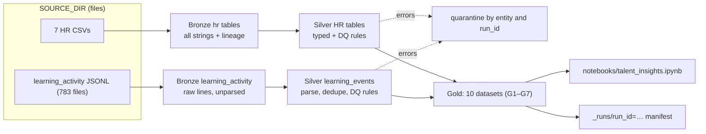

# ACME Talent Pipeline

A single-file PySpark job (`job.py`) that turns ACME's HR extracts and learning-activity logs into a
Bronze → Silver → Gold lake, with data-quality rules, quarantine and a run manifest. The Gold layer
answers seven talent questions (performance trend, competency gaps, promotion shortlist, learning,
attrition context, team outcomes, competency coverage), shown in `notebooks/talent_insights.ipynb`.

## Architecture



## Run locally

```bash
cd data/talent-pipeline
source .venv/bin/activate        # Python 3.11, pyspark 3.5.0; activate sets JAVA_HOME=Java 17 and unsets SPARK_HOME
python job.py                    # full run, ~90 s (latest run manifest); writes ./lake
pytest -q                        # 14 unit + 4 integration tests (integration runs the job twice, ~4 min)
cd notebooks && jupyter nbconvert --to notebook --execute --inplace talent_insights.ipynb
jupyter nbconvert --to html --output-dir ../docs talent_insights.ipynb
```

Run only the fast tests with `pytest -q -m "not integration"`.

## Configuration (environment variables only)

| Variable | Default | Meaning |
|---|---|---|
| `IS_LOCAL` | `true` | Local run flag (recorded in the manifest) |
| `SOURCE_DIR` | `../../sampleData/data-engineering-sample-performance-scenario/data-engineering-performance-talent-management` (relative to `job.py`) | Folder with the 7 CSVs and `learning_activity/` |
| `LAKE_ROOT` | `<job.py folder>/lake` | Lake root; local path or `s3a://bucket` |

`org.apache.hadoop:hadoop-aws:3.3.4` is added to Spark only when `SOURCE_DIR` or `LAKE_ROOT` starts with `s3a://`.
Nothing runs at import time; all config is read in `main()`.

## Lake layout

```
{LAKE_ROOT}/bronze/hr/<table>/ingest_date=YYYY-MM-DD/      CSV rows as strings + _run_id, _ingested_at, _source_system, _source_file
{LAKE_ROOT}/bronze/learning_activity/year=/month=/day=/     raw line (value), _line_no, _source_file, _record_hash
{LAKE_ROOT}/silver/<hr table>/                              typed, validated, dq_warnings
{LAKE_ROOT}/silver/learning_events/event_year=/event_month=/
{LAKE_ROOT}/quarantine/<entity>/run_id=<id>/                 error rows + rule_ids, dq_reasons (written only if non-empty)
{LAKE_ROOT}/gold/<dataset>/
{LAKE_ROOT}/_runs/run_id=<id>/                               run manifest (JSON, written through Spark)
```

## Data quality

- **Rules are declarative** (`RULES` in `job.py`, section 4): `Rule(rule_id, entity, column, severity, condition, description)`.
  Generic rules come from the schema contract (not-null, type cast, unique PK, foreign key); domain rules follow `schema.sql` CHECKs.
- **Errors → quarantine.** A row that fails several rules is quarantined once, with every `rule_id` and reason.
- **Warnings → flag.** Rows are kept; failed warning rule_ids are listed in `dq_warnings`.
- **NULL = pass**, as in SQL CHECK constraints, so a missing value is reported once (by `not_null`).
- **Learning events:** malformed JSON is caught first (`_corrupt_record`), then events are **deduplicated on `event_id` before validation**, then rules run.
- **Reconciliation** is enforced per step (`read = written + quarantined + deduped`, the run fails otherwise):

  `29,868 lines = 13 malformed + 152 duplicates + 76 null employee_id + 53 invalid date + 29,574 valid`

- HR: 0 rows quarantined. Warnings kept and flagged: 666 reviews whose period ended before hire, 234 assessments
  before hire, 38 learning events using `notes` instead of `text`, 5,161 learning events before hire.

## Gold datasets

| # | Dataset | Grain | Business question |
|---|---|---|---|
| G1 | `employee_performance_history` | employee × review period | Q1 How are ratings moving? |
| G1b | `employee_performance_summary` | employee | Q1 (latest rating, `derived_rating_trend`) |
| G2 | `employee_competency_gaps` | employee × competency | Q2 Where are the biggest gaps? |
| G3 | `promotion_readiness` | employee | Q3 Analytic promotion shortlist (not an HR decision) |
| G4 | `learning_progress` | employee × course | Q4 Learning progress |
| G4b | `learning_summary` | employee | Q4 (totals, zeros not nulls) |
| G5 | `attrition_risk_context` | employee | Q5 Context for recorded attrition risk |
| G5b | `attrition_by_trend` | attrition risk × rating trend | Q5 (association, not causation) |
| G6 | `team_performance_outcomes` | team | Q6 Ratings vs project outcomes |
| G7 | `competency_distribution` | competency × department | Q7 Competency coverage |

Recorded values keep their source names; calculated columns are prefixed `derived_`. Every Gold write is checked for duplicate grain keys.
Key results: trend 898 improving / 872 stable / 230 declining; gaps −1/0/1/2 = 1480/1527/668/325 (critical 325);
shortlist 357; attrition risk Low/Medium/High 1,077/612/311; 27 of 100 teams have projects (33 projects).

## Design decisions

- **Folder `data/talent-pipeline/`.** Infra discovers Python jobs as `data/<dir>/requirements.txt` and skips folders starting with `_`
  (`infra/locals.tf`), so the job lives here rather than in `data/_examples/python-job/`.
- **Example's structure.** Function names follow the example job: `create_spark_session`, `ingest_into_bronze`, `transform_to_silver`, `aggregate_to_gold`, `main`. No Iceberg.
- **Single `job.py`.** The cloud Helm job receives only `job.py` + `requirements.txt`; tests, notebook and docs stay local.
- **`pyspark==3.5.0`** in `requirements.txt` (nothing else) to match the cloud image (Spark 3.5.0, Python 3.11, Java 17).
- **Files instead of Postgres.** Bronze reads the CSVs and JSONL directly from `SOURCE_DIR` (decision of 15 Oct, PLAN.md §0).
- **Idempotent re-runs.** Bronze overwrites only its own partition (dynamic overwrite); Silver and Gold are full overwrites.
  The integration test runs the job twice and checks identical counts, no duplicate keys and identical Gold content hashes.

## Known limitations

- Only 2 review periods (a trend is a single change) and 1 talent-review cycle.
- Projects link only to teams (27 of 100) and have no dates; there is no "key competency" flag and no course-to-competency mapping.
- Counts after Silver differ slightly from raw profiling: 38 `notes` events after dedupe, 3,255 completion-without-enrollment
  employee×course pairs (39 lines / 3,262 raw (initial profiling, PLAN.md §2)).
- **Not done yet:** Postgres/JDBC sources and the cloud deployment (S3 lake, EKS job, infra changes in PLAN.md §8) are designed but not implemented or run.

## How to verify

- [`docs/test_evidence.md`](docs/test_evidence.md): exact test command, full pytest output (18 passed) and the table of numbers asserted by the integration test.
- [`docs/source_to_target.md`](docs/source_to_target.md): column mapping per layer with the rule IDs applied.
- [`notebooks/talent_insights.ipynb`](notebooks/talent_insights.ipynb) / [`docs/talent_insights.html`](docs/talent_insights.html): findings for Q1–Q7.
- The latest run manifest: `lake/_runs/run_id=<id>/` (status, per-step counts, quarantine and warning counts by rule).
